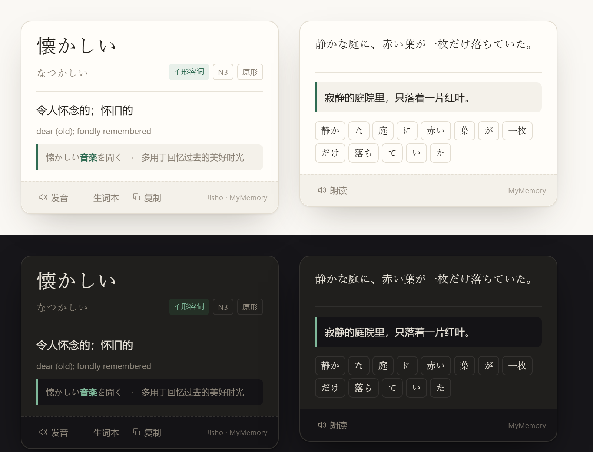
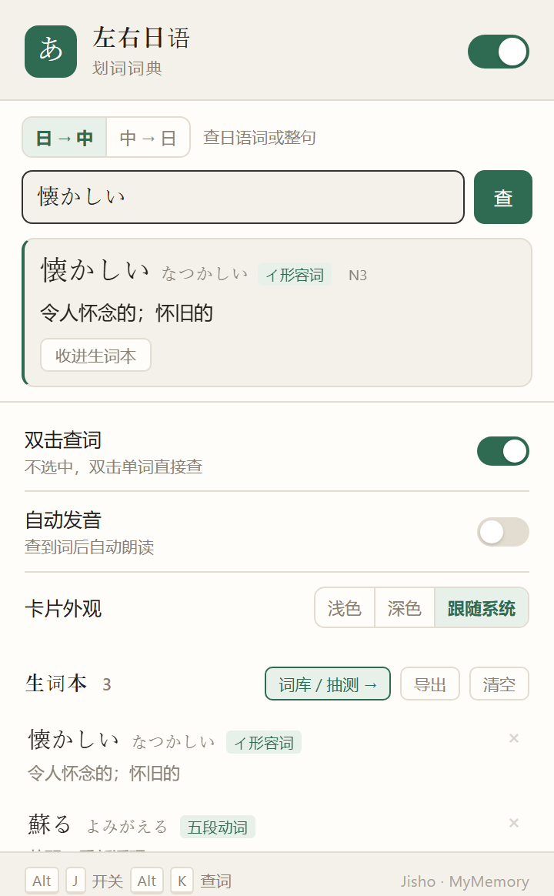
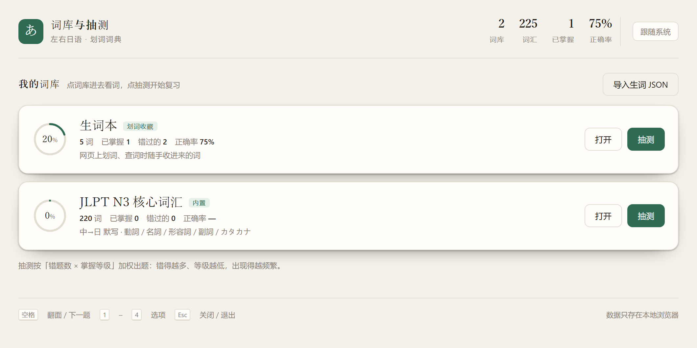
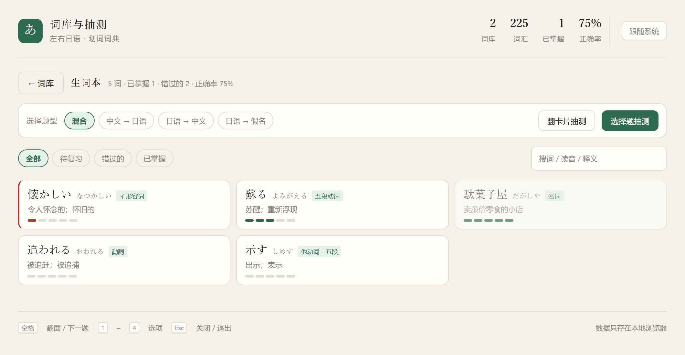
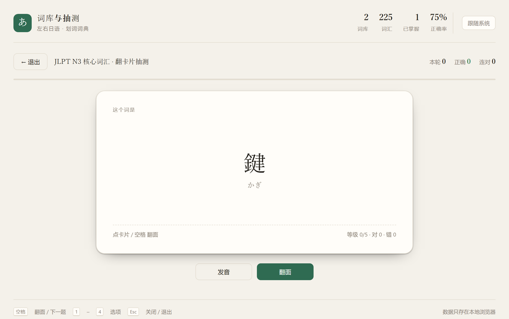
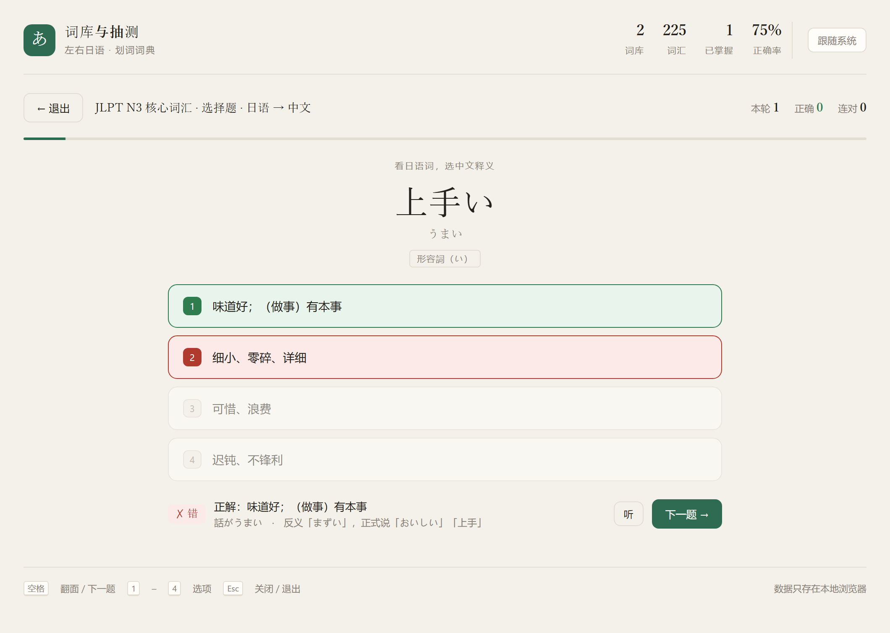
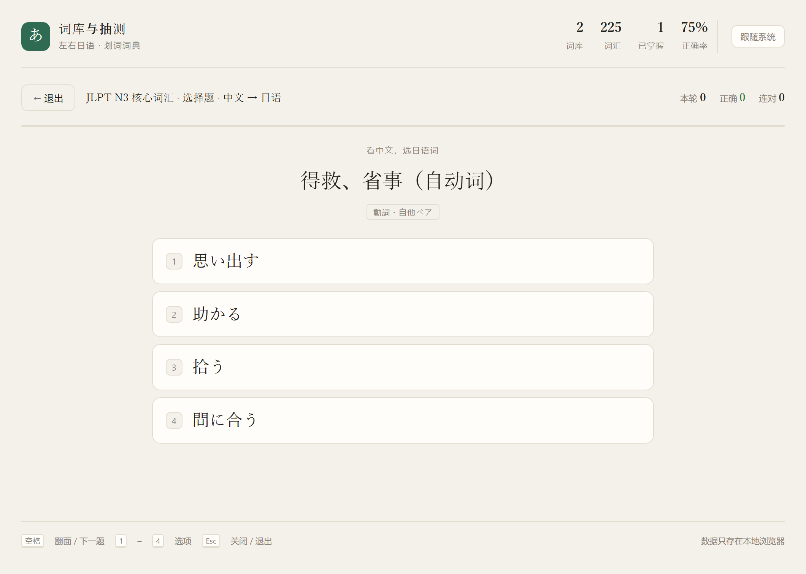
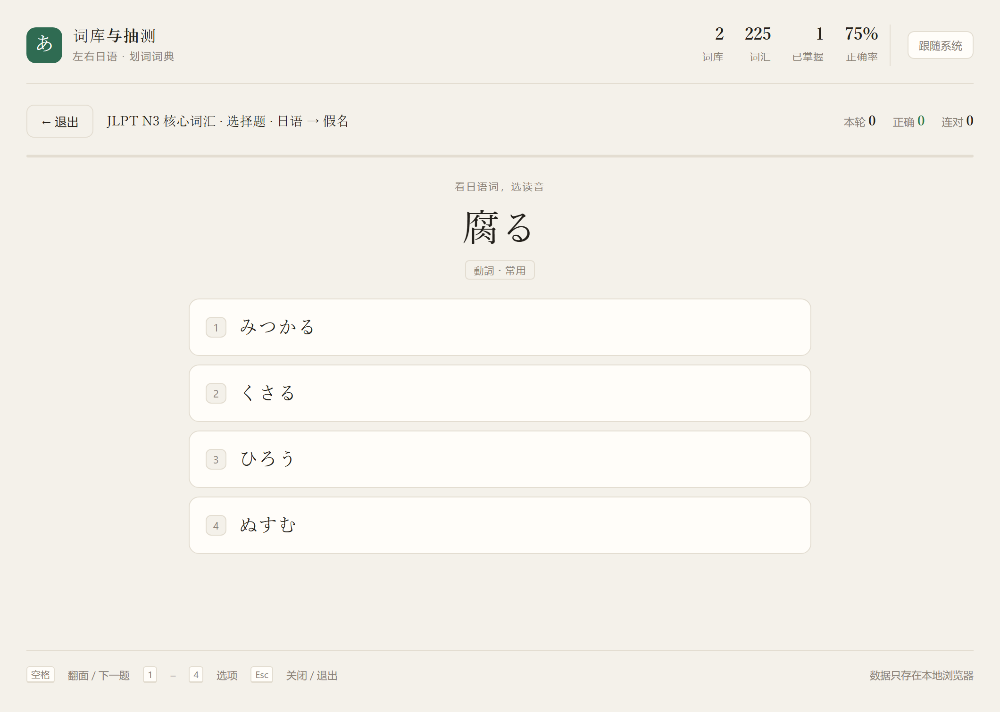
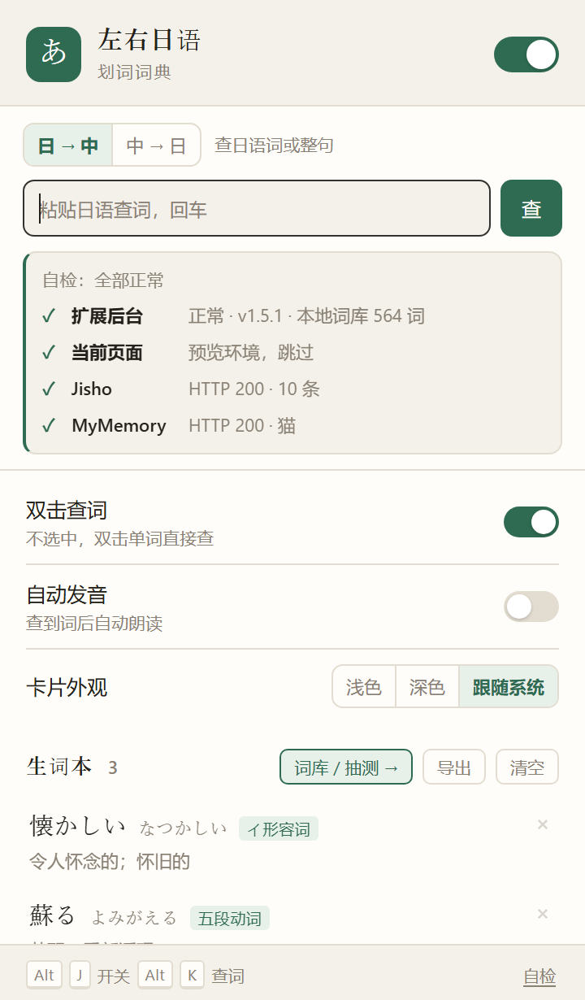

# ZuoYou Japanese · Select-to-Look-Up Dictionary

[简体中文](README.md) · **English**

> A zero-dependency, build-free Chrome extension for reading Japanese: select a word to see its reading, part of speech and Chinese gloss, translate whole sentences in place, and turn saved words into weighted flashcards and quizzes.


## Overview

This project is a select-to-look-up dictionary extension for Chrome / Edge, built around the act of reading Japanese. It closes the loop from **looking a word up** to **keeping it** to **reviewing it**, without leaving the page you are reading.

Most selection tools on the browser stop at the lookup: a definition appears, the popup closes, and that is the end of it. The lookup itself still breaks the reading — switch to a dictionary site, copy, paste, switch back — and the words have nowhere to go once found, so they rarely make it into later review. The extension keeps all three steps inside the same surface:

- **Look up** — selecting Japanese opens a card with the reading, part of speech, JLPT level and Chinese gloss. Select a sentence instead and the card returns a translation plus segmentation, where every token stays clickable, so the reading is never interrupted.
- **Keep** — a single click on the card saves the word with its form, reading, part of speech and gloss intact; nothing has to be copied a second time.
- **Review** — the built-in study page draws questions by mastery level and miss count, offering flashcards and three multiple-choice types (Chinese → Japanese, Japanese → Chinese, Japanese → kana), carrying a word from "looked up" to "learned".

```
select ─▶ card (reading / POS / gloss / sentence translation) ─▶ vocabulary list ─▶ study (flip cards · three quiz types)
```

The engineering stays deliberately plain: Manifest V3 and vanilla JavaScript, no framework, no build step, no runtime dependencies — clone it and load it. A local 564-word dictionary answers common words with zero latency, and both fallback lookups (Jisho, MyMemory) work without an API key.



---

## Contents

- [Overview](#overview)
- [Features](#features)
- [Screenshots](#screenshots)
- [Installation](#installation)
- [Usage](#usage)
- [How quizzing works](#how-quizzing-works)
- [Implementation notes](#implementation-notes)
- [Data model](#data-model)
- [Project layout](#project-layout)
- [Local development](#local-development)
- [Troubleshooting](#troubleshooting)
- [Known limitations](#known-limitations)
- [Privacy](#privacy)
- [Roadmap](#roadmap)

---

## Features

**Lookup**

- Select Japanese and a card appears instantly: reading (kana), part of speech, JLPT level, Chinese gloss, English gloss, example hints
- A single word returns a dictionary entry; a full sentence returns a translation plus segmentation, and every token in it can be clicked for its own entry
- Double-click a word to look it up without selecting (can be turned off); right-click menu works on the current selection
- The card is draggable and closes on `Esc`; `Alt+J` suspends selection handling, `Alt+K` opens a lookup box for pages where selection is impossible

**Two-way translation**

- Japanese → Chinese: words or full sentences
- Chinese → Japanese: type Chinese, get Japanese, with clickable segmentation on the result
- Long text is split on `。！？` and translated chunk by chunk, so nothing gets silently truncated mid-sentence

**Vocabulary list + quizzing**

- One click on the card saves the word; the popup can list, delete, and export it as JSON
- A bundled 220-word JLPT N3 deck sits alongside your own list
- Two study modes: **flashcards** (self-assessed "knew it / didn't") and **multiple choice** (four options, keys `1`–`4`)
- Three multiple-choice types: **Chinese → Japanese** (pick the word), **Japanese → Chinese** (pick the gloss), **Japanese → kana** (pick the reading); lock one or mix all three at random
- Every word tracks a mastery level (0–5) and a right/wrong record, so weak words surface more often; right/wrong is also tracked per **question type**, so a mixed round leans toward the types you keep failing
- Filter the deck by "needs review / missed / mastered", or search by reading and gloss

## Screenshots

The toolbar popup: lookup box (for PDFs), settings, vocabulary list, and the study entry point in the top right.



Deck list → single deck: progress ring, mastered, missed, accuracy, and a 5-bar mastery meter per word. The type selector sits above the word list.

| Deck list | Single deck (5 bars = mastery level) |
| --- | --- |
|  |  |

Quizzing comes in two shapes: self-assessed flashcards, or multiple choice with three question types you can lock or mix.

| Flashcards: reveal, then self-assess | Multiple choice · Japanese → Chinese |
| --- | --- |
|  |  |

| Multiple choice · Chinese → Japanese | Multiple choice · Japanese → kana |
| --- | --- |
|  |  |

> The interface ships in Chinese, since the extension is aimed at Chinese speakers learning Japanese; the screenshots reflect that locale.

## Installation

Chrome or Edge, about a minute, no packaging step and no `npm install`:

1. Open `chrome://extensions` (or `edge://extensions`)
2. Turn on **Developer mode** in the top right
3. Click **Load unpacked** and pick this directory
4. Pin the icon to the toolbar (puzzle-piece menu → pin)

> After editing the source, hit ↻ on the extensions page and reload the target tab — any page that already has `content.js` injected needs a reload.

## Usage

| Action | Result |
| --- | --- |
| Select Japanese text | Card appears: an entry for a word, a translation plus segmentation for a sentence |
| Select Chinese text (direction set to Chinese → Japanese) | Card appears with Japanese output; the segmentation is clickable |
| Double-click a word | Looks it up without selecting (toggleable in settings) |
| Right-click → look up "…" | Looks up the current selection from the context menu |
| `Alt + J` | Temporarily suspend / resume selection handling |
| `Alt + K` | Open the lookup box (for PDFs and other pages without selectable text) |
| `Esc` or click outside | Close the card |
| Drag the card header | Move the card wherever it's convenient |

**Studying from the vocabulary list**: click the extension icon → **词库 / 抽测 →** in the vocabulary section, which opens the full-page study view in a new tab. Pick a deck → open it → choose the question type in the bar above the list (mixed / Chinese → Japanese / Japanese → Chinese / Japanese → kana) → hit **翻卡片抽测** (flashcards) or **选择题抽测** (multiple choice). The **抽测** button on the deck list starts a round directly with whichever type you used last.

Study shortcuts: `space` flips the card / advances, `1`–`4` pick an option, `1` / `2` mark "didn't know" / "knew it", `Esc` exits.

### Looking words up in a PDF

Chrome's built-in PDF viewer is a separate component: the text inside isn't in the page DOM, so **no selection-based extension can read a selection there**. The workaround:

1. Select Japanese in the PDF → `Ctrl + C`
2. Press `Alt + K` to open the lookup box
3. `Ctrl + V` → `Enter`

Whatever you paste is auto-detected as a word or a sentence and translated accordingly. PDFs rendered by pdf.js in a regular tab behave like any other page and support selection normally.

## How quizzing works

Each word gets a study record, keyed by deck + word:

```js
{ w: 3, r: 7, lv: 2, t: 1794749778381 }   // 3 wrong, 7 right, mastery level 2
```

- **Correct**: `lv + 1` (capped at 5), `r + 1`
- **Wrong**: `lv - 1` (floored at 0), `w + 1`
- **`lv = 5`** counts as mastered and drops out of the pool; only when the whole deck reaches 5 does it fall back to plain cycling

Questions are drawn by weighted random (roulette-wheel selection):

```
weight = (6 - lv) × (1 + min(wrongCount, 6) × 7)
```

In other words, *how unfamiliar* and *how often missed* compound: a brand-new word weighs 6, one miss multiplies it by 8, six misses cap it at ×43. Words you just got wrong come back almost immediately; words you keep answering well sink to the bottom on their own.

A few deliberate choices:

- **Weighted sampling rather than weighted sorting** — wrong answers come up often without one word ever monopolising the round
- Drawn words enter a `recent` queue whose length scales with the deck (`max(1, words × 0.4)`, capped at 8), so a small deck doesn't keep replaying the same word
- A round is 10–20 questions depending on how many words are available, ending with an accuracy figure and the words you missed; clicking a missed word drills it alone
- Filter the deck to "missed" before starting and the round covers only your mistakes

### The three question types

Flashcards always ask "see the word, recall the meaning" and are self-assessed; the type selector applies to multiple choice only.

| Type | Prompt | Options | Requires |
| --- | --- | --- | --- |
| Chinese → Japanese | Chinese gloss (with a POS tag) | Four Japanese words | Gloss |
| Japanese → Chinese | Japanese word + reading | Four Chinese glosses | Gloss |
| Japanese → kana | Japanese word (**reading hidden**) | Four kana readings | Reading |

The pool is filtered by type before a round starts: **Japanese → kana** keeps only words whose reading differs from their spelling, so a round can't degrade into flashcards halfway through.

Distractors prefer words of the same part of speech or category (quiz a verb and the options are mostly verbs), and any option that would also count as correct is dropped — identical glosses and homophones never make it into the list.

In **mixed** mode the type is itself drawn by weight, so a type you keep failing shows up more often, with a small bonus for types you haven't tried yet to guarantee coverage:

```
typeWeight = 1 + min(missesForThisType, 5) × 2 + (neverAttempted ? 1.5 : 0)
```

This is why study records carry an extra `k` layer, separating "knows the meaning" from "remembers the reading":

```js
{ w: 3, r: 7, lv: 2, t: 1794749778381,
  k: { cn2jp: { r: 4, w: 1 }, jp2kana: { r: 0, w: 2 } } }   // knows the meaning, not the reading
```

The end-of-round summary breaks accuracy down by type (`CN→JP 4/5 · JP→kana 1/3`), and each word's detail sheet shows its history per type.

## Implementation notes

### Lookup pipeline

A lookup falls back through three stages — local dictionary, dictionary API, translation API. A hit short-circuits the chain, and each later stage only fills in the fields the earlier ones left empty.

```
selection
  │  normalize: collapse whitespace, cap length
  ├─▶ local dictionary (564 entries, hash index)    hit ─▶ card renders, no network
  │
  └─▶ miss
        ├─ Jisho (JMdict)   → reading / POS / JLPT level / English gloss
        └─ MyMemory         → Chinese gloss / sentence translation (runs in parallel)
```

The two remote calls fail independently: if either times out or is rate-limited, only the fields it owns degrade (a missing Chinese gloss leaves the English one in place) while the card's structure and behaviour stay intact, so a single failing service never blanks the panel.

### Lemmatization and exact-match validation

The dictionary API matches on substrings, so `追われる` returns `追われる身`; taking the first result would attach the wrong meaning to the query. Results pass two checks before rendering:

1. **Length heuristic** — a result longer than the query is treated as a possible compound prefix match and is not accepted outright.
2. **Deinflection** — the query is reduced to its dictionary form under godan, ichidan, i-adjective, causative, passive and potential rules (`追われる → 追う`) and looked up again; the replacement is accepted only on an **exact match**.

When neither check succeeds, the card keeps the approximate entry and labels it "contains this word" rather than passing it off as the exact one. Reading-level mismatches (`書か → 書架`) go through the same filter.

### Segmentation and word/sentence classification

Japanese has no inter-word spaces, so segmentation relies on the browser's built-in `Intl.Segmenter('ja', { granularity: 'word' })` — no third-party model to download and nothing to initialise.

Word-versus-sentence is decided on the segmentation output: any one of four signals routes the input down the sentence path — terminal punctuation, embedded whitespace, a particle before the last two tokens, or ≥5 tokens together with ≥14 characters. Particles alone are unreliable, since the segmenter splits `食べられませんでした` into pieces that include an isolated `で`; requiring a position and a size keeps the rule from firing on conjugated words.

### Rendering and style isolation

The content script is injected into every frame (`all_frames: true`). The card's host is a `position: fixed` element covering the viewport with `pointer-events: none`, and the card itself lives inside a Shadow DOM:

- **Bidirectional isolation** — page CSS never reaches the card, and the card's styles never leak into the page.
- **Viewport-sized host** — the same viewport coordinates position the card inside iframes.
- **Pass-through hit testing** — the host's empty area does not intercept clicks meant for the page.

### Messaging and caching

- **Messaging** — page and background exchange request/response messages over `chrome.runtime.sendMessage` / `chrome.tabs.sendMessage`; settings changes are broadcast to every tab through `chrome.storage.onChanged`, so they take effect without a reload.
- **Caching** — `chrome.storage.local`, with direction-prefixed keys (`s2:` Japanese → Chinese, `z2j:` Chinese → Japanese) and a 14-day TTL. Hits return instantly and keep traffic on the public endpoints down.

### Engineering constraints

- **No build step** — the source is the artifact: load the directory and it runs, and the debug loop is just "edit, reload the extension".
- **No runtime dependencies** — only MV3 and native browser APIs (`Intl.Segmenter`, `SpeechSynthesis`).
- **No API keys** — both remote services are public endpoints, so it works the moment it is installed.

## Data model

Everything lives in `chrome.storage.local`:

| Key | Contents |
| --- | --- |
| `jp_vocab` | Vocabulary list: `[{ id, word, reading, pos, meaning, createdAt }]` |
| `jp_study_stats` | Study records: `{ [deckId]: { [word]: { w, r, lv, t, k } } }`, where `k` holds per-type right/wrong |
| `jp_settings` | Settings: `{ enabled, theme, dblclick, autoSpeak, direction, quizType }` |

The exported vocabulary file shares its format with the main app's `词库.json`, so the two can import each other:

```json
{
  "app": "zrjp-vocab",
  "version": 1,
  "words": [
    { "id": "a1", "word": "懐かしい", "reading": "なつかしい",
      "pos": "イ形容词", "meaning": "令人怀念的；怀旧的", "createdAt": 1762000000000 }
  ]
}
```

**导入生词 JSON** (top right of the study page) accepts this shape — or a plain array — and merges it into the list, de-duplicating by word.

## Project layout

```
.
├── manifest.json       Extension manifest (MV3)
├── background.js       Lookup layer: local dictionary → Jisho → MyMemory, with cache and deinflection
├── content.js          Page layer: selection detection, card UI (Shadow DOM)
├── dict-local.js       Offline dictionary (564 words)
├── popup.html/css/js   Toolbar popup: lookup box, settings, vocabulary list, study entry point
├── study.html/css/js   Study page: deck list / word list / flashcards / three quiz types / summary
├── deck-n3.js          Bundled N3 deck (220 words, generated from deck-n3.json)
├── icons/              Icons
├── docs/               Screenshots used in the READMEs
└── preview/            Preview and self-test pages, usable without installing
    ├── demo.html           Lookup card preview (?mode=sent for sentences)
    ├── card-state.html     Deinflection / approximate-result card states
    ├── iframe-test.html    Positioning check inside iframes
    └── diag.html           Diagnosing selection problems
```

> Chrome rejects extension directories containing files or folders that start with an underscore (`_test` triggers `Cannot load extension with file or directory name _test`), which is why the preview folder is called `preview`.

## Local development

There's no build step — reload the extension after edits. To inspect the UI on its own:

```bash
# Open directly in the browser; sample data renders without the extension installed
study.html                                    # study page (bundled sample list + records)
study.html?theme=light                        # force the light theme
study.html?deck=n3&quiz=choice                # jump straight into a multiple-choice round
study.html?deck=n3&quiz=choice&type=jp2kana   # specify Japanese → kana
study.html?deck=n3&quiz=choice&finish=1       # jump to the round summary
study.html?deck=n3&quiz=choice&pick=1         # jump to the answered state
study.html?deck=vocab&word=蘇る               # open a single word's detail sheet
popup.html?theme=light&demo=1                 # popup with a sample lookup
preview/demo.html?mode=sent&theme=light       # lookup card
```

Without `chrome.storage` these pages fall back to in-memory sample data, which is what makes them convenient for screenshots and styling work.

Self-check when touching the data model: new `jp_vocab` fields must be reflected in `content.js` (saving) and `popup.js` (list / export); `jp_study_stats` is read and written only by `study.js`.

## Troubleshooting

The **自检** (self-check) link at the bottom right of the popup runs four checks in sequence and prints each result inline:



| Check | Healthy output | When it fails |
| --- | --- | --- |
| Background | `正常 · v1.5.1 · 本地词库 564 词` | `没有响应` means the service worker never started — hit the reload button on the extension card at `chrome://extensions` |
| Current page | `划词脚本在运行` | `没有划词脚本` means the page yields no selection: Chrome's built-in PDF viewer, `chrome://` pages, or a tab opened before the extension was installed |
| Jisho | `HTTP 200 · N 条` | A 403 usually means the network rewrote the User-Agent or an intermediary blocked the request; retry on another network |
| MyMemory | `HTTP 200 · <translation>` | `MYMEMORY WARNING` means the anonymous quota is exhausted; Chinese glosses degrade to English only |

The card distinguishes its three failure modes as well — *no such word*, *no API response*, *no background response* — rather than collapsing them into a single "not found" message.

Two things worth knowing:

- **Refresh the tab after reloading the extension.** Scripts in an already-open page lose their channel to the new background process, and every lookup fails until the tab is refreshed. The card says `扩展后台没有响应` in that case.
- **The offline dictionary covers 564 words.** Everything else depends on the network, so offline use is limited to those entries.

## Known limitations

- **Coverage**: personal names, proper nouns and invented fictional words are mostly missing — try a shorter query
- **Network**: Jisho and MyMemory are hosted outside mainland China and are occasionally slow or unreachable from some networks; the local 564-word dictionary keeps working offline
- **MyMemory rate limit**: roughly 5000 words per day anonymously, beyond which responses degrade to English glosses only
- **Pages with no selectable text** (the extension cannot read a selection — a platform constraint, not an implementation defect): Chrome's built-in PDF viewer, canvas-rendered pages (Google Docs, image-based sites), Japanese inside images (needs OCR), text with `user-select: none`, and `chrome://` pages
- **Machine translation quality**: long Chinese/Japanese sentences go through MyMemory, and complex written Japanese comes out stiff; per-word glosses are far more reliable than full-sentence output
- Words are de-duplicated by surface form, so homographs with different meanings (e.g. `かける`) are stored only once

## Privacy

No data collection, no telemetry, no third-party analytics. Only the words you actively select or type are sent to Jisho and MyMemory for lookup; the vocabulary list and study records stay in your local `chrome.storage.local`.

## Roadmap

- [ ] Group the vocabulary list by tag or source page
- [ ] Audio-based and handwritten recall modes
- [ ] Anki / CSV import
- [ ] Optional LLM-assisted explanations (bring your own key) for long sentences and nuance
- [ ] Languages beyond Japanese — architecturally it's just another dictionary and segmentation rule set

## Credits

Dictionary data from [Jisho](https://jisho.org) (JMdict); translations from [MyMemory](https://mymemory.translated.net). The N3 deck was compiled from my own study notes.

## License

This project is proprietary software. Copyright is held by the author, and all rights are reserved. The source code is published for viewing and educational reference only.

**Permitted**: downloading and using the original, unmodified version for personal, non-commercial purposes.

**Prohibited without prior written permission from the copyright holder**: modifying the software or creating derivative works based on it; copying, redistributing or republishing the source code or substantial portions of it; commercial use, sale or commercial redistribution; distributing modified or derivative versions.

All rights not expressly granted are reserved by the copyright holder. See [LICENSE](LICENSE) for the full terms.
