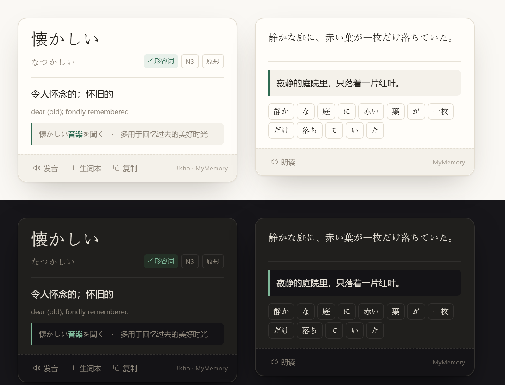
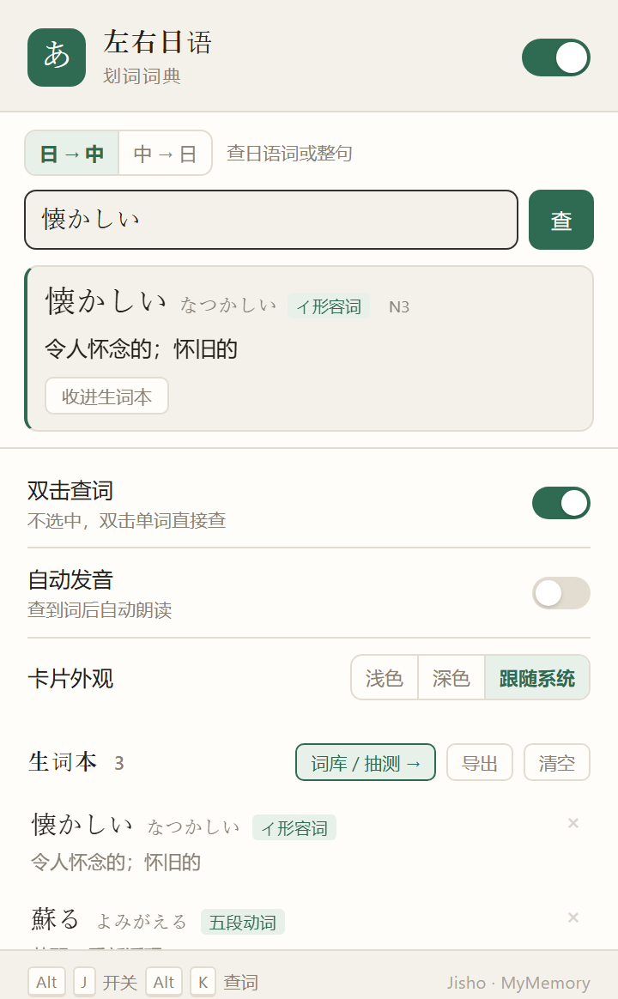
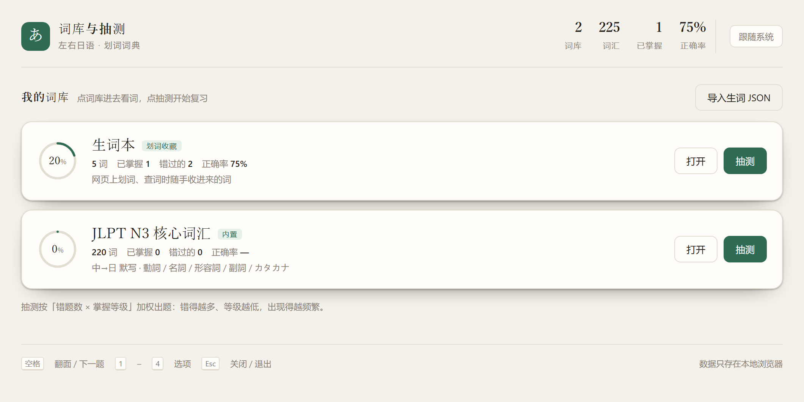
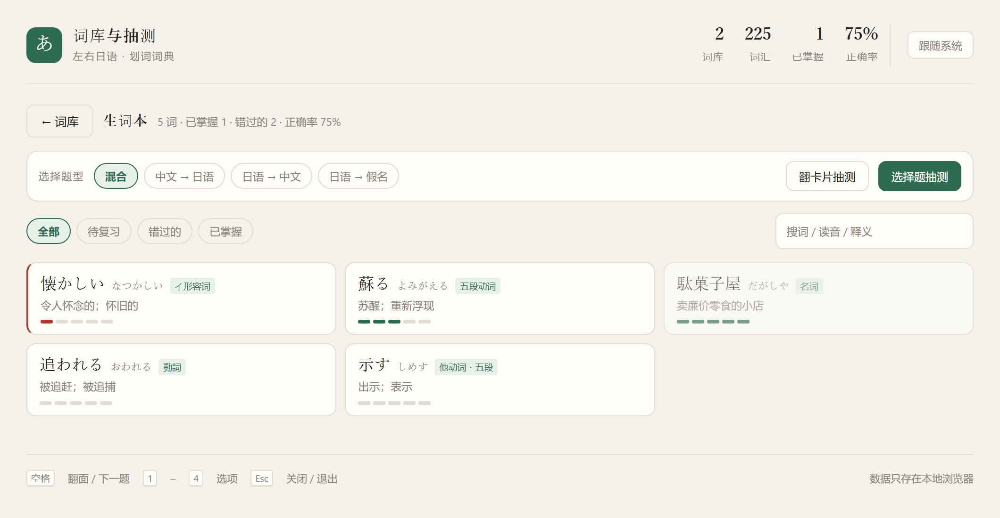
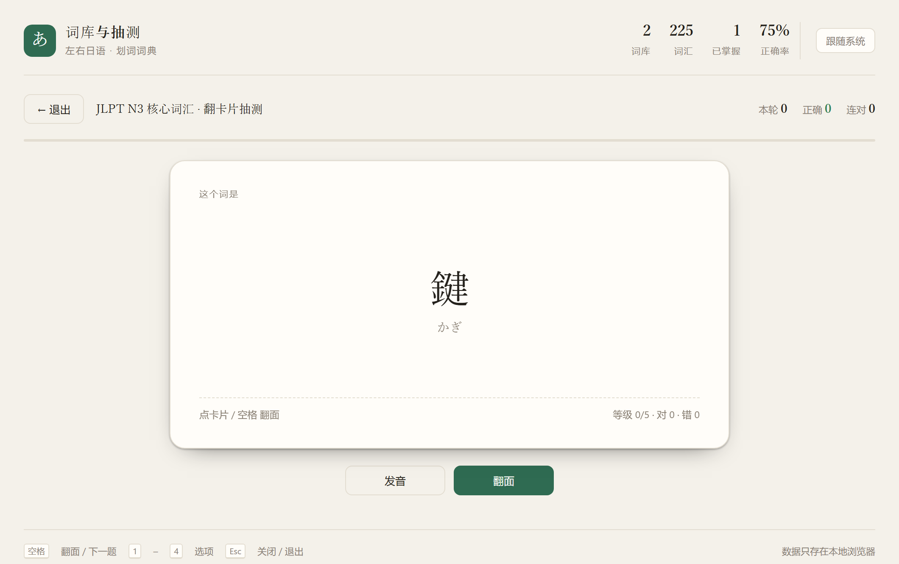
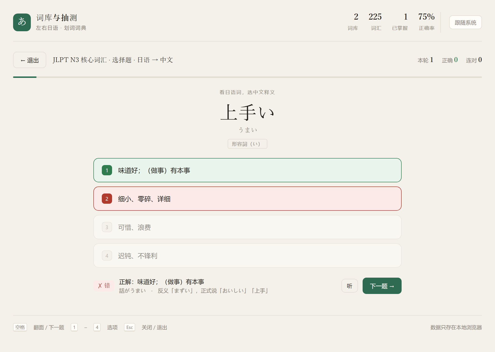
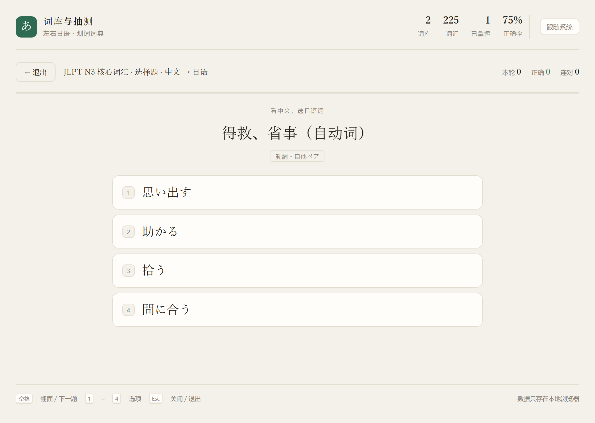
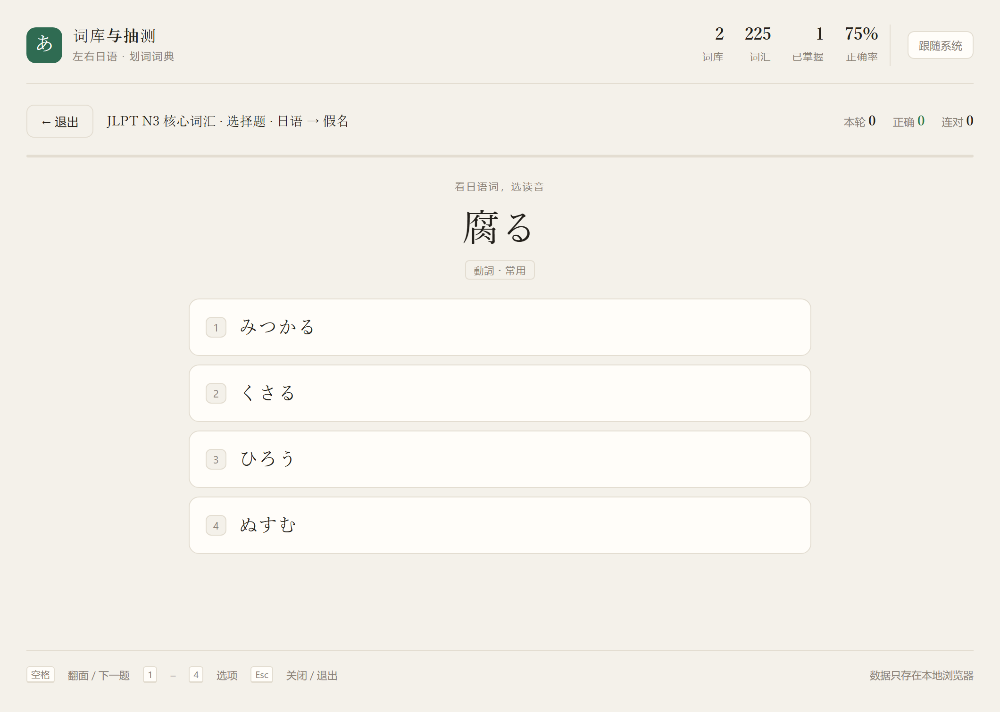

# 左右日语 · 划词词典

**简体中文** · [English](README.en.md)

> 零依赖、免构建的 Chrome 划词日语词典：划词即查，一点收藏，按错题权重复习。


## 项目概要

本项目是一个面向日语阅读场景的 Chrome / Edge 划词词典扩展，把「查词 → 收藏 → 复习」串成一条闭环，全过程不离开当前页面。

现有的浏览器划词工具大多止步于「查」：选中出释义，关闭即结束。查词这个动作本身也仍在打断阅读——切到词典站点、复制粘贴、再切回来，位置和节奏都已丢失；查过的词又缺少归宿，难以进入后续复习。本项目把这三步收在同一个界面内完成：

- **查**：网页上选中日语即出卡片，给出读音、词性、JLPT 等级与中文释义；选中整句则输出译文与分词，句中每个词可继续点开，阅读不中断
- **存**：卡片上一步收藏，词形、读音、词性与释义随词入库，无需二次抄录
- **练**：内置抽测页按掌握等级与错题次数加权出题，支持翻卡片与中→日 / 日→中 / 日→假名三种选择题，把「查过」推进到「记住」

```
划词 ─▶ 卡片（读音 / 词性 / 释义 / 整句翻译）─▶ 生词本 ─▶ 抽测（翻卡片 · 三种选择题）
```

工程上不做额外抽象：Chrome MV3 + 原生 JavaScript，无框架、无构建、无运行时依赖，克隆后即可加载。本地 305 词离线词库保证常用词零延迟，两处补充查询（Jisho、MyMemory）均无需注册 Key。



---

## 目录

- [项目概要](#项目概要)
- [功能](#功能)
- [截图](#截图)
- [安装](#安装)
- [使用](#使用)
- [抽测机制](#抽测机制)
- [实现要点](#实现要点)
- [数据结构](#数据结构)
- [目录结构](#目录结构)
- [本地开发](#本地开发)
- [已知限制](#已知限制)
- [隐私](#隐私)
- [Roadmap](#roadmap)

---

## 功能

**查词**

- 选中日语即时出卡片：读音（假名）、词性、JLPT 等级、中文释义、英文释义、例句提示
- 单词查词条，整句出译文 + 分词；句子里每个词都能点开继续查
- 双击单词直接查（可关），右键菜单查选中内容
- 卡片可拖动、可 Esc 关闭；`Alt+J` 临时关闭划词，`Alt+K` 打开查词框（给 PDF 用）

**双向翻译**

- 日 → 中：词条 / 整句
- 中 → 日：输入中文出日语，译文的分词同样可点
- 长句按 `。！？` 切段逐段翻译后拼接，不会被截断成半句

**生词本 + 抽测**

- 卡片一点即收藏，扩展面板里可查看、删除、导出 JSON
- 内置 220 词 N3 词库，与自己的生词本并列
- 两种抽测：**翻卡片**（自评「记住了 / 没记住」）与**选择题**（四选一，键盘 1–4）
- 选择题有三种题型：**中文 → 日语**（看释义选词）、**日语 → 中文**（看词选释义）、**日语 → 假名**（看词选读音）；可锁定一种，也可「混合」随机穿插
- 每个词记掌握等级（0–5）与对错次数，错题越多、等级越低的词出题权重越高；每个**题型**的对错也分开记，混合模式会多考你错得多的那一类
- 词库页可按「待复习 / 错过的 / 已掌握」筛选、按读音或释义搜索

## 截图

工具栏面板：查词框（给 PDF 用）、设置、生词本，右上角是抽测入口。



词库列表 → 单个词库：进度环、已掌握、错过的、正确率，每个词带 5 格掌握等级；词表上方是题型选择器。

| 词库列表 | 单个词库（5 格是掌握等级） |
| --- | --- |
|  |  |

抽测分两类：翻卡片自评，或做选择题。选择题有三类题型，可以锁一种也可以混合。

| 翻卡片：先自评，再对答案 | 选择题 · 日语 → 中文：答错标出正解 |
| --- | --- |
|  |  |

| 选择题 · 中文 → 日语 | 选择题 · 日语 → 假名 |
| --- | --- |
|  |  |

## 安装

Chrome / Edge，1 分钟，不需要打包、不需要 `npm install`：

1. 打开 `chrome://extensions`（Edge 是 `edge://extensions`）
2. 右上角打开「开发者模式」
3. 点「加载已解压的扩展程序」，选择本目录
4. 建议把图标固定到工具栏（拼图图标 → 图钉）

> 改完代码要在扩展页点 ↻ 刷新，并刷新目标网页；`content.js` 注入的页面必须重载。

## 使用

| 操作 | 效果 |
| --- | --- |
| 选中一段日语 | 出卡片：单个词查词条，一整句出翻译 + 分词 |
| 选中一段中文（方向设为「中 → 日」） | 出卡片，翻成日语，译文分词可点 |
| 双击一个词 | 不选中也能直接查（设置里可关） |
| 右键 → 查「…」 | 用右键菜单查选中内容 |
| `Alt + J` | 临时开 / 关划词，不想被打扰时用 |
| `Alt + K` | 打开查词框（PDF 等无法划词的页面） |
| `Esc` / 点空白处 | 关闭卡片 |
| 拖动卡片顶部 | 把卡片挪到顺手的位置 |

**进词库背单词**：点扩展图标 → 生词本一栏的「词库 / 抽测 →」，会在新标签页打开整页的词库。选一个词库 → 打开看词 → 在上方「选择题型」挑好（混合 / 中文 → 日语 / 日语 → 中文 / 日语 → 假名）→ 点「翻卡片抽测」或「选择题抽测」。词库列表上的「抽测」按钮会按你上次选的题型直接开考。

抽测页快捷键：`空格` 翻面 / 下一题，`1`–`4` 选选项，`1` / `2` 评「没记住 / 记住了」，`Esc` 退出。

### PDF 怎么查

Chrome 自带的 PDF 阅读器是独立组件，里面的文字不在网页 DOM 里，**任何划词扩展都取不到选区**。所以走这条路：

1. 在 PDF 里选中日语 → `Ctrl + C`
2. 按 `Alt + K` 打开查词框
3. `Ctrl + V` → 回车

贴进来的是句子就按句子翻，会自动判断是一词还是一句。若是 pdf.js 渲染的网页版 PDF，则和普通网页一样可以直接划词。

## 抽测机制

每个词按「词库 + 词」维度记一条学习记录：

```js
{ w: 3, r: 7, lv: 2, t: 1794749778381 }   // 错 3 次、对 7 次、掌握等级 2
```

- **答对**：`lv + 1`（上限 5），`r + 1`
- **答错**：`lv - 1`（下限 0），`w + 1`
- **`lv = 5`** 视为已掌握，先不再出题；整个词库都到 5 才回退成循环复习

出题用加权随机（轮盘赌），权重：

```
weight = (6 - lv) × (1 + min(错次数, 6) × 7)
```

即「越生疏 × 错得越多」双重加权：新词权重 6，错 1 次 ×8，错 6 次封顶 ×43。这样刚错的词会紧接着再考，长期答对的词自然沉底。

细节取舍：

- **不用纯权重排序**，而是按权重抽——既保证错题高频，又不至于永远只考那一个词
- 抽过的词进 `recent` 队列，词库越小队列越短（`max(1, 词数 × 0.4)`，上限 8），避免同一个词连着刷屏
- 一轮 10–20 题（按可练词数定），结束给正确率与本轮错词，点错词可以单独练
- 词库页先筛「错过的」再点抽测，就只练错题

### 三种选择题型

翻卡片固定是「看词想义」（自评对错），不参与下面的题型选择；三种题型是选择题的分支。

| 题型 | 题干 | 选项 | 需要的字段 |
| --- | --- | --- | --- |
| 中文 → 日语 | 中文释义（带词性标签） | 四个日语词 | 释义 |
| 日语 → 中文 | 日语词 + 读音 | 四个中文释义 | 释义 |
| 日语 → 假名 | 日语词（**不显示读音**） | 四个假名 | 读音 |

出题前先按题型过滤题库：`日 → 假名` 只保留有读音的词（本身就写作假名的词出不了这道题），所以不会抽到一半突然退化成翻卡片。

干扰项优先取同词性 / 同分类的词（考动词时，选项基本也都是动词），并剔掉「选它也算对」的项：释义完全相同、读音相同（同音词）的都不会混进选项。

「混合」模式在三种题型之间加权抽：某个词的某个题型错得越多，这类题越常出现；没做过的题型给一点初始加成，保证三类都会轮到。

```
题型权重 = 1 + min(该题型错次, 5) × 2 + (没做过 ? 1.5 : 0)
```

学习记录因此多一层 `k`，把「认识意思」和「记得读音」分开算：

```js
{ w: 3, r: 7, lv: 2, t: 1794749778381,
  k: { cn2jp: { r: 4, w: 1 }, jp2kana: { r: 0, w: 2 } } }   // 认识意思，读音没记住
```

结算页会把这一轮的题型正确率拆开显示（`中→日 4/5 · 日→假名 1/3`），词条详情里也能看到每个题型的历史成绩。

## 实现要点

### 查询管线

一次查询按「本地词库 → 词典 API → 翻译 API」三级回退：前一级命中即短路，后一级只补前一级缺失的字段。

```
选区文本
  │  归一化：折叠空白、超长截断
  ├─▶ 本地词库（305 条，哈希索引）    命中 ─▶ 直接渲染卡片，无网络请求
  │
  └─▶ 未命中
        ├─ Jisho（JMdict）  → 读音 / 词性 / JLPT 等级 / 英文释义
        └─ MyMemory         → 中文释义 / 整句译文（与上一步并行）
```

两个远端接口分别容错：任一接口超时或被限流，只降级它负责的字段（缺中文释义时保留英文释义），卡片结构与交互不受影响，不会因单点失败整块空白。

### 词形归一化与精确匹配

词典接口使用包含匹配，查询 `追われる` 会命中 `追われる身`，直接取首条会造成词义错配。查询结果在渲染前经过两道校验：

1. **长度判据**：返回词长于查询词时，判定为可能的复合词前缀匹配，不直接采用；
2. **辞书形还原**：按五段、一段、形容词、使役、被动、可能等活用规则把查询词还原为辞书形（`追われる → 追う`）后重新查询，仅当返回词与查询词完全一致（exact match）才替换。

两条均不成立时，卡片保留接口返回的近似词并标注「含此词」，不以近似结果充当精确词条。读音维度的误匹配（`書か → 書架`）同样经精确匹配过滤。

### 分词与词 / 句判定

日语词间无空格，分词使用浏览器原生 `Intl.Segmenter('ja', { granularity: 'word' })`，不引入第三方分词模型，无模型下载与初始化开销。

「一词还是一句」在分词结果上判定，四条信号任一成立即走句子路径：句末标点、含空白字符、助词出现在倒数第二位之前、分词数 ≥ 5 且字符数 ≥ 14。仅凭「含助词」并不可靠——分词器会把 `食べられませんでした` 切出孤立的「で」，因此用位置与规模双重约束排除这种误判。

### 渲染与样式隔离

content script 注入所有 frame（`all_frames: true`）；卡片宿主是 `position: fixed`、铺满视口且 `pointer-events: none` 的容器，卡片本体挂在 Shadow DOM 内：

- **双向隔离**：页面样式不进入卡片，卡片样式不外溢到页面；
- **视口级宿主**：宿主铺满视口，卡片在 iframe 内也能用同一套视口坐标定位；
- **点击透传**：`pointer-events: none` 使宿主空白区域不拦截页面原有交互。

### 通信与缓存

- **消息**：页面与后台通过 `chrome.runtime.sendMessage` / `chrome.tabs.sendMessage` 完成请求-响应；设置变更经 `chrome.storage.onChanged` 广播到全部标签页，免刷新即时生效。
- **缓存**：`chrome.storage.local`，键按翻译方向加前缀（`s2:` 日→中、`z2j:` 中→日），TTL 14 天，过期即失效；命中即时返回，同时降低公共接口调用量。

### 工程约束

- **无构建**：源码即产物，加载目录即可运行，调试回路只有「改文件 → 刷新扩展」；
- **无运行时依赖**：仅使用 MV3 与浏览器原生 API（`Intl.Segmenter`、`SpeechSynthesis`）；
- **无密钥**：两个远端服务均为公开接口，安装即可用。

## 数据结构

全部存在 `chrome.storage.local`：

| 键 | 内容 |
| --- | --- |
| `jp_vocab` | 生词本：`[{ id, word, reading, pos, meaning, createdAt }]` |
| `jp_study_stats` | 学习记录：`{ [词库id]: { [词]: { w, r, lv, t, k } } }`，`k` 是分题型对错 |
| `jp_settings` | 设置：`{ enabled, theme, dblclick, autoSpeak, direction, quizType }` |

导出的生词本与主程序 `词库.json` 同格式，可以互相导入：

```json
{
  "app": "zrjp-vocab",
  "version": 1,
  "words": [
    { "id": "a1", "word": "懐かしい", "reading": "なつかしい",
      "pos": "イ形容词", "meaning": "令人怀念的；怀旧的", "createdAt": 1762000000000 }
  ]
}
```

抽测页右上角「导入生词 JSON」接受这种格式（也接受纯数组），按词去重合并进生词本。

## 目录结构

```
.
├── manifest.json       扩展配置（MV3）
├── background.js       查询层：本地词库 → Jisho → MyMemory，带缓存与变形还原
├── content.js          页面层：划词检测、卡片 UI（Shadow DOM）
├── dict-local.js       离线词库（305 词）
├── popup.html/css/js   工具栏面板：查词框、设置、生词本、进词库的入口
├── study.html/css/js   抽测页：词库列表 / 词表 / 翻卡片 / 三类选择题 / 结算
├── deck-n3.js          内置 N3 词库（220 词，由 deck-n3.json 生成）
├── icons/              图标
├── docs/               README 用截图
└── preview/            不装扩展也能看的预览与自测页
    ├── demo.html           划词卡片预览（?mode=sent 看句子）
    ├── card-state.html     变形还原 / 近似结果两种卡片状态
    ├── iframe-test.html    iframe 内定位验证
    └── diag.html           划词失效排查
```

> Chrome 不允许扩展目录里出现下划线 `_` 开头的文件或目录（`_test` 会报
> `Cannot load extension with file or directory name _test`），所以预览目录叫 `preview`。

## 本地开发

没有构建步骤，改完刷新扩展即可。想单独看样式：

```bash
# 直接双击打开，用示例数据渲染，不需要装扩展
study.html                 # 抽测页（内置样例生词与学习记录）
study.html?theme=light     # 强制浅色
study.html?deck=n3&quiz=choice            # 直接进入选择题（默认题型）
study.html?deck=n3&quiz=choice&type=jp2kana   # 指定「日语 → 假名」
study.html?deck=n3&quiz=choice&finish=1       # 直接看结算页
study.html?deck=n3&quiz=choice&pick=1         # 直接看「选错」的判定态
study.html?deck=vocab&word=蘇る            # 打开某个词的详情
popup.html?theme=light&demo=1             # 面板 + 一次示例查询
preview/demo.html?mode=sent&theme=light   # 划词卡片
```

这些页面在没有 `chrome.storage` 的环境里会自动用内存里的样例数据兜底，方便截图和调样式。

数据结构改动的自查清单：`jp_vocab` 增字段要同步 `content.js`（收藏）与 `popup.js`（列表 / 导出）；`jp_study_stats` 的结构只被 `study.js` 读写。

## 已知限制

- **查不到**：人名、专有名词、动漫自造词大概率没有，选短一点的词再试
- **网络**：Jisho / MyMemory 都在境外，偶尔慢；本地 305 词永远离线可用
- **MyMemory 限流**：匿名每天约 5000 词，超了会退化成只显示英文释义
- **无可取文字的页面**（扩展无法获取选区，非实现缺陷）：Chrome 内置 PDF 阅读器、canvas 渲染的页面（Google Docs、图片版网页）、图片中的日文（需 OCR）、`user-select: none` 的文本、`chrome://` 内置页面
- **机翻质量**：中 / 日长句靠 MyMemory，复杂书面语会译得生硬；词条释义比整句翻译可靠
- 一个词库的去重键是「词形」，同形不同义（如 `かける`）只会存一条

## 隐私

不收集数据、不上报统计、没有第三方分析。只有你**主动划或查的词**会发给 Jisho 与 MyMemory 用于查询；生词本与学习记录只存在本机 `chrome.storage.local`。

## Roadmap

- [ ] 生词本按标签 / 来源网页分组
- [ ] 抽测加「听音选词」与手写默写模式
- [ ] 支持导入 Anki / CSV
- [ ] 可选的大模型精解通道（自填 API Key，用于长句与语感说明）
- [ ] 日语以外的语种（架构上只差一份词库与分词规则）

## 致谢

词典数据来自 [Jisho](https://jisho.org)（JMdict），翻译来自 [MyMemory](https://mymemory.translated.net)。N3 词库整理自本人的复习笔记。

## License

MIT
